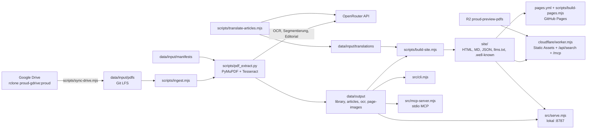
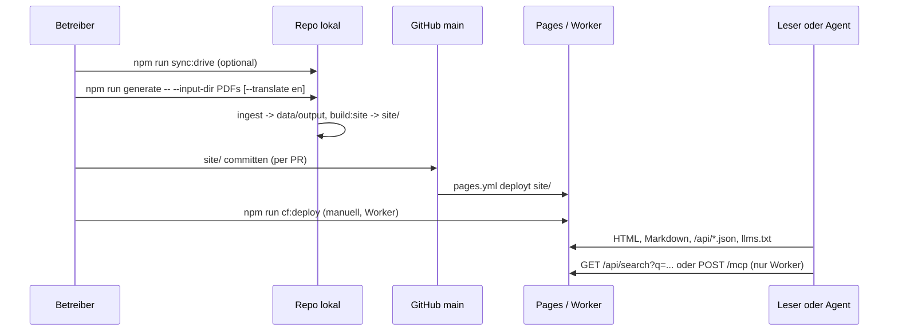

# proud.de archive engine

Digitales Archiv des Magazins proud (Berlin, 2009-2014): Magazin-PDFs werden lokal per OCR in Artikel zerlegt.
Derselbe Bestand erscheint als HTML, Markdown, JSON, `llms.txt`, CLI und MCP-Server.
Für Leser, Suchmaschinen und AI-Agents.

## Logs

- [CHANGELOG.md](CHANGELOG.md): Änderungen pro Commit, neueste zuerst
- [PROMPTLOG.md](PROMPTLOG.md): Vorgaben von emino
- [RELEASE_NOTES.md](RELEASE_NOTES.md): ältere Release Notes (Juni 2026)

## Status

| Feld | Wert |
|---|---|
| Version | v0.1.1 |
| Datum | 2026-10-14 |
| updated by | hermes-agent for emino |
| main HEAD | `c9d23b27` |
| GitHub Pages | https://eminogrande.github.io/proud-de/ (`.github/workflows/pages.yml`, push auf `main` mit Änderungen in `site/**`) |
| Cloudflare Worker | `wrangler.jsonc`: Worker `proud-de`, Custom Domain `proud.xn--wp9h.tk`, R2 `proud-preview-pdfs`. Deploy nur manuell (`npm run cf:deploy`), kein CI |
| proud.de | geplant (`docs/HANDOFF.md`), laut Repo noch nicht aufgeschaltet |
| Veröffentlicht | Ausgabe 01 (`site/magazines/01-proud-issuu-output`, 65 Artikelordner in `site/articles`) |

## Architektur



## User flow



## Komponenten

| Komponente | Pfad | Rolle |
|---|---|---|
| Stammdaten | `config/site.json`, `config/contact.json`, `config/legal.json` | Domain, Locales, Drive-Remote, Pfade, Impressum |
| PDF-Eingang | `data/input/pdfs/` | Roh-PDFs der Ausgaben (Git LFS) |
| Manifeste | `data/input/manifests/` | manuelle Artikelgrenzen pro PDF |
| Übersetzungen | `data/input/translations/<locale>/` | Übersetzungs-Overrides pro Artikel |
| Ausgabe | `data/output/` | Bibliothek, Artikel, OCR-Cache, Previews, Seitenbilder |
| Drive-Sync | `scripts/sync-drive.mjs` | `rclone` Kopie aus Google Drive |
| Ingest | `scripts/ingest.mjs`, `scripts/pdf_extract.py` | PDF-Extraktion, OCR, Artikelsegmentierung |
| Orchestrator | `scripts/generate.mjs` | Ingest, Übersetzung, Site-Build in einem Lauf |
| Übersetzung | `scripts/translate-articles.mjs`, `scripts/scaffold-translations.mjs` | AI-Übersetzung via OpenRouter, Skelette |
| Site-Build | `scripts/build-site.mjs`, `scripts/lib/editorial.mjs` | erzeugt `site/` |
| Hero-Bilder | `scripts/crop-heroes.py` | beschnittene Artikelbilder |
| Pages-Build | `scripts/build-pages.mjs` | schreibt `site/` auf Pages-Origin und Base-Path um |
| Cloudflare-Deploy | `scripts/deploy-cloudflare.mjs`, `wrangler.jsonc` | `wrangler deploy` mit Token aus `.env.local` |
| Live-Audit | `scripts/audit-live.mjs` | prüft öffentliche Endpunkte, PageSpeed API |
| Public-Export | `site/` | committeter statischer Export |
| Worker | `cloudflare/worker.mjs` | Assets, Markdown-Negotiation, PDFs aus R2, `/api/search`, `/mcp` |
| CLI | `src/cli.mjs` | lokale Recherche in der Bibliothek |
| MCP stdio | `src/mcp-server.mjs`, `src/lib/mcp-core.mjs` | MCP über stdio |
| MCP-Tools | `src/lib/mcp-shared.mjs` | Tool-Definitionen für stdio, lokal-HTTP und Worker |
| Lokaler Server | `src/serve.mjs` | HTTP-Server mit Search-API und MCP-Sessions |
| Bibliothek/Suche | `src/lib/store.mjs`, `src/lib/search.mjs` | Laden und Volltextsuche |
| Tests | `tests/editorial.test.mjs`, `tests/worker.test.mjs` | `node --test` |
| Pages-Workflow | `.github/workflows/pages.yml` | Deploy von `site/` auf GitHub Pages |
| Doku | `docs/` | Handoff, Deploy-Checkliste, Design-System, Recherche, Presse |

## API / Endpunkte

### HTTP

| Methode | Pfad | Wo | Auth | Zweck |
|---|---|---|---|---|
| GET, HEAD, OPTIONS | `/api/search?q=&limit=` | Worker, `src/serve.mjs` (ohne OPTIONS) | keine | Volltextsuche über `site/api/library.json` |
| POST, OPTIONS | `/mcp` | Worker | keine | stateless Streamable-HTTP-MCP |
| POST, DELETE | `/mcp` | `src/serve.mjs` | keine, `mcp-session-id` Header | MCP mit Sessions |
| GET, HEAD | `/assets/pdfs/<key>` | Worker | keine | Original-PDF aus R2 `PDFS_BUCKET`, Range-Requests |
| GET | `/.well-known/mcp.json`, `/.well-known/ai-catalog.json`, `/.well-known/api-catalog`, `/.well-known/http-message-signatures-directory` | Worker | keine | Discovery mit festen Content-Types |
| GET, HEAD | alle anderen Pfade | Worker, `src/serve.mjs` | keine | statische Dateien aus `site/`, bei `Accept: text/markdown` die `index.md` |
| GET | `/api/*.json`, `/llms.txt`, `/llms-full.txt`, `/sitemap.xml`, `/feed.xml`, `/robots.txt` | statisch, auch Pages | keine | maschinenlesbarer Bestand |

GitHub Pages liefert nur statische Dateien: kein `/api/search`, kein `/mcp`, keine Markdown-Negotiation (`docs/HANDOFF.md`).

### MCP-Tools (Server `proud-archive`)

| Tool | Parameter | Zweck |
|---|---|---|
| `list_magazines` | `limit` | alle Ausgaben mit Basis-Metadaten |
| `list_articles` | `magazineSlug`, `limit` | Artikel, optional pro Ausgabe |
| `search_articles` | `query` (Pflicht), `limit` | Volltextsuche |
| `get_article` | `slug` (Pflicht) | Artikel mit Markdown und Metadaten |
| `get_magazine` | `slug` (Pflicht) | Ausgabe mit Artikelliste |

### CLI (`npm run cli -- <cmd> [--json]`)

| Befehl | Zweck |
|---|---|
| `status` | Bestand zählen |
| `magazines` | Ausgaben listen |
| `articles [magazine-slug]` | Artikel listen |
| `search <query>` | Volltextsuche |
| `show <article-slug>` | Artikel anzeigen |
| `magazine <magazine-slug>` | Ausgabe anzeigen |
| `export <article-slug> [markdown\|json]` | Artikel exportieren |

## Start

```bash
python3 -m venv .venv && .venv/bin/pip install -r requirements.txt
npm install
cp .env.example .env.local   # Werte lokal eintragen, nie committen
npm run generate -- --input-dir "/pfad/zu/pdfs"
npm run serve                # http://127.0.0.1:8787
npm test                     # node --test tests/*.test.mjs
```

Weitere npm-Skripte: `sync:drive`, `ingest`, `ingest:drive`, `build:site`, `build:all`, `scaffold:translations`, `translate:articles`, `cli`, `mcp`, `audit:live`, `status`, `cf:whoami`, `cf:dev`, `cf:deploy`, `cf:deploy:local`.

Externe Tools: `rclone` (Drive-Sync), `tesseract` (lokale OCR, optional), `wrangler` (devDependency).

Umgebungsvariablen (nur Namen, gelesen im Code):

| Bereich | Variablen |
|---|---|
| OpenRouter | `OPENROUTER_API_KEY`, `PROUD_OPENROUTER_API_KEY`, `PROUD_OPENROUTER_URL`, `PROUD_OPENROUTER_REFERER`, `PROUD_OPENROUTER_TITLE` |
| OCR | `PROUD_ENABLE_OCR`, `PROUD_OCR_LANG`, `PROUD_OCR_PROVIDER`, `PROUD_OCR_OPENROUTER_MODEL`, `PROUD_OCR_OPENROUTER_PDF_ENGINE`, `PROUD_OCR_REFRESH` |
| AI-Pässe | `PROUD_ENABLE_AI_LAYOUT`, `PROUD_ENABLE_AI_SEGMENTATION`, `PROUD_ENABLE_AI_EDITORIAL`, `PROUD_AI_REFRESH`, `PROUD_LAYOUT_MODEL`, `PROUD_LAYOUT_IMAGE_SCALE`, `PROUD_LAYOUT_MIN_CONFIDENCE`, `PROUD_LAYOUT_REFRESH`, `PROUD_EDITORIAL_MODEL`, `PROUD_TRANSLATION_MODEL` |
| Bilder | `PROUD_EXPORT_PAGE_IMAGES`, `PROUD_PAGE_IMAGE_SCALE`, `PROUD_PAGE_IMAGE_QUALITY` |
| Drive | `PROUD_DRIVE_REMOTE`, `PROUD_DRIVE_PATH` |
| Site/Build | `PROUD_PUBLIC_DOMAIN`, `PROUD_ISSN`, `PAGES_ORIGIN`, `PAGES_BASE_PATH`, `PAGES_LASTMOD`, `PAGES_CNAME`, `SOURCE_ORIGIN` |
| Server/Deploy | `PORT`, `CLOUDFLARE_API_TOKEN` |
| Worker-Bindings | `ASSETS`, `PDFS_BUCKET` |

`.env.example` listet zusätzlich `FAL_KEY`; im Code wird es nicht gelesen (UNVERIFIED, wofür es gedacht ist).

## Ziel
## Ziel

- PDFs aus einem Ordner einlesen
- Artikel pro Magazin automatisch erkennen
- Bei Bedarf manuelle Overrides per Manifest erlauben
- Volltextsuche über alle Artikel anbieten
- Artikel an Agents über MCP, `llms.txt`, JSON und Markdown ausliefern
- Einen öffentlichen Export für Suchmaschinen und AI-Agents erzeugen
- Mehrsprachige Ausspielung pro Artikel vorbereiten

## Workflow

1. PDFs in `data/input/pdfs/` legen oder per `--input-dir` auf einen anderen Ordner zeigen.
2. Python-Umgebung installieren:

```bash
python3 -m venv .venv
.venv/bin/pip install -r requirements.txt
```

3. Node-Abhängigkeiten installieren:

```bash
npm install
```

4. Optional lokale Secrets in `.env.local` hinterlegen:

```bash
cp .env.example .env.local
```

Für Cloud-OCR über OpenRouter:

```bash
OPENROUTER_API_KEY=...
PROUD_OCR_PROVIDER=openrouter-page
PROUD_OCR_OPENROUTER_MODEL=google/gemini-2.5-flash
PROUD_OCR_OPENROUTER_PDF_ENGINE=mistral-ocr
PROUD_ENABLE_AI_LAYOUT=0
```

5. Schnellster Komplettlauf für einen beliebigen PDF-Ordner:

```bash
npm run generate -- --input-dir "/pfad/zu/deinen/pdfs"
```

Mit englischer Testausgabe:

```bash
npm run generate -- --input-dir "/pfad/zu/deinen/pdfs" --translate en
```

Mit mehreren Sprachen:

```bash
npm run generate -- --input-dir "/pfad/zu/deinen/pdfs" --translate en,fr
```

Nur Übersetzung plus Neu-Build auf vorhandenem Bestand:

```bash
npm run generate -- --skip-ingest --translate en --refresh-translations
```

6. Inhalte nur extrahieren:

```bash
npm run ingest
```

Alternativ direkt aus Google Drive synchronisieren und dann extrahieren:

```bash
npm run sync:drive
npm run ingest:drive
```

7. Lokal durchsuchen:

```bash
npm run cli -- status
npm run cli -- magazines
npm run cli -- articles
npm run cli -- search berlin
```

8. Public-Export bauen:

```bash
npm run build:site
```

9. Lokalen HTTP-/MCP-Server starten:

```bash
npm run serve
```

10. Stdio-MCP-Server starten:

```bash
npm run mcp
```

## Public Output

Der Build unter `site/` erzeugt unter anderem:

- `index.html` und `index.md`
- `articles/<slug>/index.html` und `index.md`
- `magazines/<slug>/index.html` und `index.md`
- `api/*.json`
- `sitemap.xml`
- `robots.txt`
- `llms.txt` und `llms-full.txt`
- `/.well-known/api-catalog`
- `/.well-known/mcp/server-card.json`
- `/.well-known/agent-skills/index.json`

Der lokale HTTP-Server kann zusätzlich:

- bei `Accept: text/markdown` die Markdown-Variante einer Seite liefern
- `GET /api/search?q=berlin` als Such-API bedienen
- `POST /mcp` als Streamable-HTTP-MCP-Endpunkt bedienen
- Original-PDFs unter `/assets/pdfs/...` aus R2 oder einem anderen Object Store ausliefern
- Seitenscreenshots unter `/assets/page-images/...` aus dem generierten `site/`-Export ausliefern

## Cloudflare Deploy

Für `proud.de` ist der saubere Cloudflare-Pfad aktuell:

- statische Seiten, Markdown, JSON, `llms.txt`, Agent-Skills und Well-Known-Dateien aus `site/`
- ein kleiner Worker für die dynamischen Endpunkte `/api/search` und `/mcp`

Das bedeutet konkret:

- reines Cloudflare Pages Static Hosting reicht **nicht**, wenn `GET /api/search` und Remote-MCP live bleiben sollen
- Cloudflare Pages **mit Functions** wäre möglich
- Cloudflare Workers mit Static Assets ist für dieses Projekt der klarere Zielzustand und bereits vorbereitet

Vorbereitung:

```bash
npm run build:site
```

Dann lokal oder in CI `Wrangler` verwenden:

```bash
npx wrangler dev
npx wrangler deploy
```

Oder über die Projekt-Skripte:

```bash
npm run cf:whoami
npm run cf:dev
npm run cf:deploy
```

Die Konfiguration dafür liegt in `wrangler.jsonc`:

- `assets.directory = "./site"`
- `assets.binding = "ASSETS"`
- `assets.run_worker_first = true` (Worker sieht jede Anfrage zuerst)
- R2-Binding `PDFS_BUCKET` -> Bucket `proud-preview-pdfs` (Original-PDFs unter `/assets/pdfs/`)
- Route: Custom Domain `proud.xn--wp9h.tk`

Der Worker in `cloudflare/worker.mjs`:

- serviert alle normalen Seiten weiter aus den statischen Assets
- beantwortet `GET /api/search` aus `site/api/library.json`
- beantwortet `POST /mcp` als stateless Streamable-HTTP-MCP-Endpunkt

Wichtig: Der Worker nutzt absichtlich den bereits gebauten statischen API-Bestand unter `site/api/*.json`. Dadurch gibt es in der Cloud keine Abhängigkeit auf das lokale Dateisystem. Seitenscreenshots müssen dafür im `site/`-Export liegen. Große Original-PDFs sollten auf Cloudflare nicht als normale Assets deployt werden, weil einzelne Asset-Dateien auf `25 MiB` begrenzt sind; dafür ist R2 der richtige Speicherort.

## Screenshots und OCR

Der Ingest erzeugt jetzt pro Artikel:

- eine Preview-Grafik der ersten Seite
- Seitenscreenshots für alle Seiten des Artikels

Wichtige Umgebungsvariablen:

```bash
PROUD_ENABLE_OCR=1
PROUD_OCR_LANG=deu+eng
PROUD_OCR_PROVIDER=openrouter-page
PROUD_OCR_OPENROUTER_MODEL=google/gemini-2.5-flash
PROUD_OCR_OPENROUTER_PDF_ENGINE=mistral-ocr
PROUD_ENABLE_AI_LAYOUT=0
PROUD_ENABLE_AI_SEGMENTATION=1
PROUD_ENABLE_AI_EDITORIAL=1
PROUD_AI_REFRESH=0
PROUD_OCR_REFRESH=0
PROUD_EXPORT_PAGE_IMAGES=1
PROUD_PAGE_IMAGE_SCALE=1.0
PROUD_PAGE_IMAGE_QUALITY=70
```

Bei `PROUD_OCR_PROVIDER=openrouter-page` wird jede Seite als Einzelseiten-PDF über OpenRouter mit dem `mistral-ocr` File-Parser verarbeitet. Die Rohantworten landen unter `data/output/ocr/<pdf-slug>/pages/` und werden wiederverwendet, solange `PROUD_OCR_REFRESH=0` bleibt.

Mit `PROUD_ENABLE_AI_SEGMENTATION=1` wird aus den OCR-Seiten zusätzlich eine spread-aware Artikelsegmentierung gebaut. `PROUD_ENABLE_AI_EDITORIAL=1` aktiviert einen konservativen Cleanup-Pass für längere Artikelblöcke. `PROUD_AI_REFRESH=1` erzwingt eine Neuberechnung dieser AI-Caches.

Zusätzlich läuft lokal eine Layout-Heuristik über Tesseract-Bounding-Boxes, damit auf komplexen Spreads fehlende Karten wie Event-Listings oder Doppeltitel trotzdem als einzelne Artikel erkannt werden. `PROUD_ENABLE_AI_LAYOUT=1` schaltet darüber hinaus einen optionalen Vision-Review-Pass über OpenRouter zu. Für schnelle, reproduzierbare lokale Tests empfiehlt sich zunächst `PROUD_ENABLE_AI_LAYOUT=0`.

Hinweis: Die Seitenscreenshots erhöhen den Speicherverbrauch deutlich. Dafür bekommen wir pro Artikel eine visuelle Belegschicht, die mit dem OCR-Cache und den Artikelgrenzen verknüpft bleibt.

## Mehrsprachigkeit

Mehrsprachige Pfade werden bereits erzeugt:

- Standard: `/articles/<slug>/`
- Englisch: `/en/articles/<slug>/`

Wenn noch keine Übersetzung vorhanden ist, fällt die Seite transparent auf den Originaltext zurück und markiert den Zustand als `untranslated`.

Übersetzungs-Skelette anlegen:

```bash
npm run scaffold:translations -- en
```

Danach einzelne Dateien unter `data/input/translations/en/<slug>.json` befüllen, zum Beispiel:

```json
{
  "locale": "en",
  "slug": "cognetive-cities",
  "title": "Cognitive Cities",
  "summary": "A conversation about the future of cities and Berlin as an urban lab.",
  "excerpt": null,
  "bodyText": null,
  "markdown": null
}
```

Nach Änderungen neu bauen:

```bash
npm run build:site
```

## Manuelle Artikel-Overrides

Wenn ein Magazin nicht sauber automatisch segmentiert wird, lege eine Datei unter `data/input/manifests/<pdf-slug>.json` an:

```json
{
  "magazine": {
    "title": "proud issue 01",
    "slug": "proud-issue-01",
    "publicationDate": "2019-05-01"
  },
  "articles": [
    {
      "title": "Berlin als Zustand",
      "slug": "berlin-als-zustand",
      "authors": ["Max Beispiel"],
      "startPage": 3,
      "endPage": 7,
      "tags": ["berlin", "kultur"]
    }
  ]
}
```

Die Seitenzahlen sind `1`-basiert und inklusive.

## Google Drive

Die Drive-Anbindung läuft über `rclone`. Das OAuth-Token liegt außerhalb des Repos in deiner lokalen `rclone`-Konfiguration.

Standardmäßig erwartet das Projekt die Remote `proud-gdrive:proud`. Anpassen kannst du das in `config/site.json` oder per Umgebungsvariablen:

```bash
PROUD_DRIVE_REMOTE=my-remote \
PROUD_DRIVE_PATH="mein/pfad" \
npm run sync:drive
```
