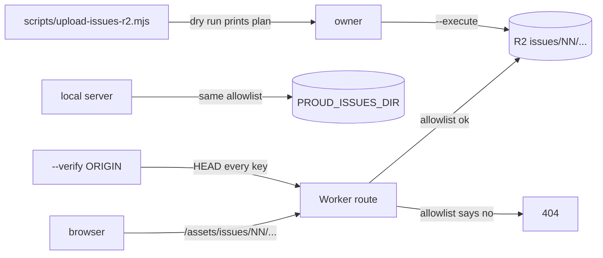

# hosting the issue files

Issue page images and the web PDFs live in the R2 bucket `proud-preview-pdfs`
under the prefix `issues/`. The Worker and the local server both answer the same
URLs, so the reader and the download button need no special casing.



## Files and URLs

| On disk, in `PROUD_ISSUES_DIR/NN/` | Public URL | R2 key |
|---|---|---|
| `pages/PPP-s.webp` | `/assets/issues/NN/pages/PPP-s.webp` | `issues/NN/pages/PPP-s.webp` |
| `pages/PPP-m.webp` | `/assets/issues/NN/pages/PPP-m.webp` | `issues/NN/pages/PPP-m.webp` |
| `pages/PPP-l.webp` | `/assets/issues/NN/pages/PPP-l.webp` | `issues/NN/pages/PPP-l.webp` |
| `proud-NN.pdf` | `/assets/issues/NN/proud-NN.pdf` | `issues/NN/proud-NN.pdf` |

Nothing else is served. The allowlist is one shared module,
`src/lib/issues-route.mjs`, used by `cloudflare/worker.mjs` and `src/serve.mjs`:

```
^([0-9]{2})/(pages/[0-9]{3}-[sml]\.webp|proud-\1\.pdf)$
```

So `review/contact.jpg` and `_state/uploaded.json` stay private, and a PDF in
folder `24` has to be named `proud-24.pdf`.

Response rules:

- GET and HEAD only, everything else is 405 with `Allow: GET, HEAD`.
- Content type `image/webp` or `application/pdf`, plus `X-Content-Type-Options: nosniff`.
- Range and conditional requests work, so the PDF viewer can seek.
- `?v=` in the URL means `Cache-Control: public, max-age=31536000, immutable`.
  Without it: `public, max-age=3600`. HTML links carry `?v=` plus the first 8 hex
  characters of the PDF sha256.
- `?download=1` on a PDF adds `Content-Disposition: attachment`.

## Local check

```
PROUD_ISSUES_DIR=/Users/eminmahrt/Developer/proud-de/data/output/issues npm run serve
curl -sI http://127.0.0.1:8787/assets/issues/24/proud-24.pdf
```

## Upload, dry run first

The script prints one line per object and totals. Dry run makes no network call
and writes nothing.

```
node scripts/upload-issues-r2.mjs --dir /Users/eminmahrt/Developer/proud-de/data/output/issues > upload-list.txt
node scripts/upload-issues-r2.mjs --dir /Users/eminmahrt/Developer/proud-de/data/output/issues --only 24
```

Read `upload-list.txt`: object count, total GB, no key with `review/` or `_state/`.

## Upload, real run

Load the token into the shell once. Nothing is printed.

```
set -a; . ./.env.local; set +a
node scripts/upload-issues-r2.mjs --dir /Users/eminmahrt/Developer/proud-de/data/output/issues --execute
```

Four files go up at a time. Keys already uploaded with the same sha256 and the
same byte count are skipped. `--force` re-uploads anyway. The ledger is
`$PROUD_ISSUES_DIR/_state/uploaded.json`.

## Audit the public URLs

```
node scripts/upload-issues-r2.mjs --dir /Users/eminmahrt/Developer/proud-de/data/output/issues --verify https://proud.xn--wp9h.tk
```

HEAD every key, compare status 200 or 206 and the byte count with the local file.
It prints `N of M OK` and exits 1 on the first mismatch. Read only.

## Roll back

One object:

```
npx wrangler r2 object delete "proud-preview-pdfs/issues/24/pages/001-s.webp" --remote
```

A whole issue:

```
for k in $(grep -o '^issues/24/[^ ]*' upload-list.txt); do npx wrangler r2 object delete "proud-preview-pdfs/$k" --remote; done
```

The whole Worker, if the route itself is wrong:

```
npx wrangler rollback
```

Deleting R2 objects is free. Deleting the files does not change the Worker, so a
404 for an uploaded file always means the object is missing.

## Size and cost

No manifests exist yet, so this is the rough figure: 32 issues, about 25 MB of
page images each and up to 40 MB per PDF.

| Item | Amount |
|---|---|
| Objects | about 6,600 (32 issues, 68 pages, 3 sizes, 1 PDF) |
| Stored | about 2 GB, worst case |
| Write operations per full upload | about 6,600 |

Prices read on https://developers.cloudflare.com/r2/pricing/ on 2026-10-30,
quoted: "Storage $0.015 / GB-month", "Class A Operations $4.50 / million
requests", "Class B Operations $0.36 / million requests", "Egress (data transfer
to Internet) Free". Free tier per month: "10 GB-month", "1 million requests"
class A, "10 million requests" class B.

That puts one full upload and about 2 GB of storage inside the free tier: 0 USD
per month at this size. Two things are UNVERIFIED: the final byte count per issue
(manifests are not written yet) and whether traffic stays under 10 million reads
per month. Re-read the price page before the upload and mark the guess in the PR.

## Limits to know

- The GitHub Pages mirror cannot serve these files. Pages has no R2 and no
  Worker route, so page images and PDFs only work on the Worker host
  `https://proud.xn--wp9h.tk`. On the mirror the reader needs the Worker origin.
- The Worker reads through the existing `PDFS_BUCKET` binding. No new binding, no
  new secret, no `wrangler.jsonc` change.
- `wrangler r2 object put` needs a token with R2 write rights for the account.
  `wrangler login` is enough on the owner machine.
