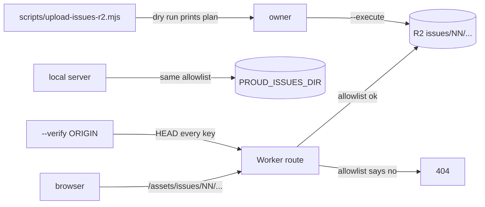

# hosting the issue files

Issue page images and the web PDFs live in the R2 bucket `proud-preview-pdfs`
under the prefix `issues/`. The Worker and the local server both answer the same
URLs, so the reader and the download button need no special casing.



## Files and URLs

| On disk, in `PROUD_ISSUES_DIR/NN/` | Public URL | R2 key |
|---|---|---|
| `pages/PPP-s.webp` | `/assets/issues/NN/pages/PPP-s.webp` | `issues/NN/pages/PPP-s.webp` |
| `pages/PPP-m.webp` | `/assets/issues/NN/pages/PPP-m.webp` | `issues/NN/pages/PPP-m.webp` |
| `pages/PPP-l.webp` | `/assets/issues/NN/pages/PPP-l.webp` | `issues/NN/pages/PPP-l.webp` |
| `proud-NN.pdf` | `/assets/issues/NN/proud-NN.pdf` | `issues/NN/proud-NN.pdf` |

Nothing else is served. The allowlist is one shared module,
`src/lib/issues-route.mjs`, used by `cloudflare/worker.mjs` and `src/serve.mjs`:

```
^([0-9]{2})/(pages/[0-9]{3}-[sml]\.webp|proud-\1\.pdf)$
```

So `review/contact.jpg` and `_state/uploaded.json` stay private, and a PDF in
folder `24` has to be named `proud-24.pdf`.

Response rules:

- GET and HEAD only, everything else is 405 with `Allow: GET, HEAD`.
- Content type `image/webp` or `application/pdf`, plus `X-Content-Type-Options: nosniff`.
- No Range header: 200 with the whole file. A real sub-range (`bytes=0-9`, `bytes=-100`, `bytes=5-`): 206 with `Content-Range`. A range R2 cannot satisfy (`bytes=99999999-`, `bytes=abc`): 200 with the whole file.
- `If-None-Match` or `If-Modified-Since` that matches: 304. A failed `If-Match`: 412. Both carry no body.
- `?v=` in the URL means `Cache-Control: public, max-age=31536000, immutable`.
  Without it: `public, max-age=3600`. HTML links carry `?v=` plus the first 8 hex
  characters of the PDF sha256.
- `?download=1` on a PDF adds `Content-Disposition: attachment`.

## Local check

```
PROUD_ISSUES_DIR=/Users/eminmahrt/Developer/proud-de/data/output/issues npm run serve
curl -sI http://127.0.0.1:8787/assets/issues/24/proud-24.pdf
```

## Upload, dry run first

The script prints one line per object and totals. Dry run makes no network call
and writes nothing.

```
node scripts/upload-issues-r2.mjs --dir /Users/eminmahrt/Developer/proud-de/data/output/issues > upload-list.txt
node scripts/upload-issues-r2.mjs --dir /Users/eminmahrt/Developer/proud-de/data/output/issues --only 24
```

Read `upload-list.txt`: object count, total GB, no key with `review/` or `_state/`.

## Upload, real run

Load the token into the shell once. Nothing is printed.

```
set -a; . ./.env.local; set +a
node scripts/upload-issues-r2.mjs --dir /Users/eminmahrt/Developer/proud-de/data/output/issues --execute
```

Four files go up at a time. Keys already uploaded with the same sha256 and the
same byte count are skipped. `--force` re-uploads anyway. The ledger is
`$PROUD_ISSUES_DIR/_state/uploaded.json`.

## Audit the public URLs

```
node scripts/upload-issues-r2.mjs --dir /Users/eminmahrt/Developer/proud-de/data/output/issues --verify https://proud.xn--wp9h.tk
```

HEAD every key, compare status 200 and the byte count with the local file.
It prints `N of M OK` and exits 1 on the first mismatch. Read only.

## Roll back

One object:

```
npx wrangler r2 object delete "proud-preview-pdfs/issues/24/pages/001-s.webp" --remote
```

A whole issue:

```
for k in $(grep -o '^issues/24/[^ ]*' upload-list.txt); do npx wrangler r2 object delete "proud-preview-pdfs/$k" --remote; done
```

The whole Worker, if the route itself is wrong:

```
npx wrangler rollback
```

Deleting R2 objects is free. Deleting the files does not change the Worker, so a
404 for an uploaded file always means the object is missing.

## Real-runtime proof

Run on 2026-10-30 with `wrangler dev --local` (workerd, wrangler 4.91.0) on port 8798, a local R2 bucket under a scratch folder, no network and no remote binding. Objects: the real `24/pages/001-s.webp` (11,798 bytes), the real `24/proud-24.pdf` (25,792,880 bytes) and a 20,000 byte `legacy.pdf` for the old route. The local server (`src/serve.mjs`, port 8793, real issue folder) gave the same status, length and range column on the 15 rows I ran against it (plain image and PDF, `?v=` with `download=1`, ranges `0-9` and `-100`, ranges `99999999-` and `abc`, both HEADs, `If-None-Match`, a wrong `If-Match`, four bad paths).

Why this was needed: R2 `get()` returns a `range` object even for a plain request, so a test of `"range" in object` answers 206 to everything. The route now compares the returned range with the file size.

| Request | Status | Content-Length | Content-Range |
|---|---|---|---|
| GET image | 200 | 11798 | none |
| GET PDF | 200 | 25792880 | none |
| GET PDF `?download=1&v=abc12345` | 200, `immutable`, `attachment` | 25792880 | none |
| GET PDF `Range: bytes=0-9` | 206 | 10 | `bytes 0-9/25792880` |
| GET PDF `Range: bytes=-100` | 206 | 100 | `bytes 25792780-25792879/25792880` |
| GET PDF `Range: bytes=25000000-` | 206 | 792880 | `bytes 25000000-25792879/25792880` |
| GET PDF `Range: bytes=99999999-` | 200 | 25792880 | none |
| GET PDF `Range: bytes=abc` | 200 | 25792880 | none |
| HEAD PDF | 200 | 25792880 | none |
| HEAD PDF `Range: bytes=0-9` | 206 | 10 | `bytes 0-9/25792880` |
| GET PDF `If-None-Match` = its etag | 304 | none | none |
| GET PDF `If-None-Match: "nope"` | 200 | 25792880 | none |
| GET PDF `If-Match: "wrong"` | 412 | 0 | none |
| GET PDF `If-Match` = its etag | 200 | 25792880 | none |
| HEAD PDF with matching `If-None-Match` / wrong `If-Match` | 304 / 412 | none | none |
| `/assets/issues/25/proud-24.pdf` (wrong folder) | 404 | 9 | none |
| `/assets/issues/24/review/contact.jpg` | 404 | 9 | none |
| `/assets/issues/_state/uploaded.json` | 404 | 9 | none |
| `/assets/issues/24/PROUD-24.PDF` (uppercase) | 404 | 9 | none |
| `/assets/issues/24%2Fproud-24.pdf` | 404 | 9 | none |
| `/assets/issues/24/pages/002-s.webp` (not uploaded) | 404 | 9 | none |
| `/assets/issues//24/proud-24.pdf`, trailing slash, page `000`, 4-digit page, variant `x`, 1-digit issue, folder only, root | 404 | 9 | none |
| POST and DELETE | 405, `Allow: GET, HEAD` | 35 | none |

Every 200 and 206 row has `X-Content-Type-Options: nosniff`, the etag of the object, and `Cache-Control: public, max-age=3600` (31536000, immutable with `?v=`). A `Range: bytes=0-9` body is 10 bytes, a plain body is 25,792,880 bytes.

Path forms: `/assets/issues/24/../24/proud-24.pdf` and `.../%2e%2e/24/...` answer 200, because the client or workerd resolves the dot segments to `/assets/issues/24/proud-24.pdf` before the route sees them (the wrangler log shows the resolved path). `..%2f` stays encoded and answers 404. `/assets/issues/../../etc/passwd` resolves to `/etc/passwd` and never reaches this route.

Old route, reported only and left unchanged: `/assets/pdfs/legacy.pdf` answers 206 for a plain GET (20,000 bytes, no Content-Range) and 206 for `Range: bytes=0-9`. The live site does the same today: `curl -sI https://proud.xn--wp9h.tk/assets/pdfs/01%20proud%20issuu_output.pdf` answers `HTTP/2 206` with no Range header, checked 2026-10-30. The same one-line fix applies there. It needs the owner's decision because the route is live.

## Size and cost

Measured with `node scripts/upload-issues-r2.mjs --dir data/output/issues` (dry run, no network), last two lines:

```
total 6608 objects, 1.844 GB
dry run: nothing uploaded, no network call
```

| Item | Amount |
|---|---|
| Objects | 6,608 (2,192 pages in 3 sizes, 32 PDFs) |
| Page images | 6,576 files, 0.866 GB |
| PDFs | 32 files, 0.978 GB (7.9 to 39.0 MB each) |
| Stored | 1.844 GB |
| Write operations per full upload | 6,608 |

Prices read on https://developers.cloudflare.com/r2/pricing/ on 2026-10-30, quoted: "Storage $0.015 / GB-month", "Class A Operations $4.50 / million requests", "Class B Operations $0.36 / million requests", "Egress (data transfer to Internet) Free". Free tier per month: "10 GB-month", "1 million requests" class A, "10 million requests" class B.

That puts one full upload and 1.844 GB of storage inside the free tier: 0 USD per month. One thing is UNVERIFIED: whether traffic stays under 10 million reads per month. Re-read the price page before the upload.

## Limits to know

- The GitHub Pages mirror cannot serve these files. Pages has no R2 and no
  Worker route, so page images and PDFs only work on the Worker host
  `https://proud.xn--wp9h.tk`. On the mirror the reader needs the Worker origin.
- The Worker reads through the existing `PDFS_BUCKET` binding. No new binding, no
  new secret, no `wrangler.jsonc` change.
- `wrangler r2 object put` needs a token with R2 write rights for the account.
  `wrangler login` is enough on the owner machine.
