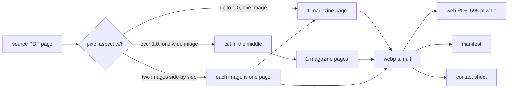

# Issue PDF pipeline (task N)

Run this once per source drop, then never again unless a source file changes.



## Commands

```
.venv/bin/python scripts/normalize-issues.py \
  --pdf-dir data/input/pdfs \
  --out data/output/issues [--only 24] [--force]
.venv/bin/python scripts/normalize-issues.py --verify \
  --out data/output/issues
```

The run adds `--progress <file>` to append one line per finished issue. `--verify`
is read only. It prints one line per issue, ends with `N of 32 OK` and exits 1 on
any failure.

## What it does per page

1. Exactly one image covering at least 98 percent of the page: take its pixels,
   honour `/Rotate`, flatten alpha on white.
2. Two or more images: take the two widest apart images in x order, left first,
   use each as one magazine page. No cutting.
3. No usable image: render the page at the image's native resolution.
4. Classify by pixel aspect. Up to 1.0 is one page, over 1.0 is a spread and is
   cut in the middle. Odd widths drop the middle column.
5. Canonical pages count from 1 in reading order, left half first.

## Output

Binaries in `PROUD_ISSUES_DIR/NN/`: `pages/PPP-s.webp` (360 px), `-m.webp`
(900 px), `-l.webp` (1800 px, never upscaled), `proud-NN.pdf` (one magazine page
per PDF page, 595 pt wide, JPEG at most 1800 px wide), `review/contact.jpg`.

Manifest `data/input/issues/NN.json` is committed and stays under 30 KB.

The run is idempotent. A manifest whose `source.sha256` matches skips the issue
unless `--force` is given. Work happens in `NN.tmp`, which becomes `NN` when the
issue is complete; the manifest is written last. Six worker processes handle the
pages of one issue, the parent assembles PDF and manifest in reading order.

## Measured result (2026-10-30)

32 issues, 2192 magazine pages. The remaining 30 issues after the two test runs
took 18 minutes wall. All 32 pass `--verify`
(`32 of 32 OK`). Total 1.7 GB under `data/output/issues`. Largest web PDF 37.19 MB,
smallest 7.49 MB. No page aspect fell outside the 5 percent band around 0.746 or
1.49. Only issue 28 is `lowRes` (808 px source).

| Issue | Source file | PDF pages | Pages | Layout | Spreads | PDF MB | Dir MB | lowRes |
|---|---|---|---|---|---|---|---|---|
| 00 | 00 proud issuu_output.pdf | 35 | 68 | spreads | 33 | 26.43 | 56 | no |
| 01 | 01 proud issuu_output.pdf | 68 | 68 | single | 0 | 35.12 | 67 | no |
| 02 | 02 proud issuu_output.pdf | 68 | 68 | single | 0 | 31.40 | 60 | no |
| 03 | 03 proud issuu_output.pdf | 68 | 68 | single | 0 | 31.68 | 60 | no |
| 04 | 04 proud issuu_output.pdf | 68 | 68 | single | 0 | 37.19 | 72 | no |
| 05 | 05 proud issuu_output.pdf | 68 | 68 | single | 0 | 33.19 | 64 | no |
| 06 | 06 proud issuu_output.pdf | 68 | 68 | single | 0 | 35.44 | 68 | no |
| 07 | 07 proud issuu_output.pdf | 68 | 68 | single | 0 | 33.66 | 64 | no |
| 08 | 08 proud issuu_output.pdf | 68 | 68 | single | 0 | 32.45 | 62 | no |
| 09 | 09 proud issuu_output.pdf | 68 | 68 | single | 0 | 35.88 | 69 | no |
| 11 | 11 proud issuu_output.pdf | 68 | 68 | single | 0 | 34.63 | 66 | no |
| 12 | 12 proud issuu_output.pdf | 68 | 68 | single | 0 | 32.38 | 62 | no |
| 13 | 13 proud issuu_output.pdf | 68 | 68 | single | 0 | 26.18 | 49 | no |
| 14 | 14 proud issuu_output.pdf | 68 | 68 | single | 0 | 32.17 | 60 | no |
| 15 | 15 proud issuu_output.pdf | 68 | 68 | single | 0 | 30.90 | 58 | no |
| 16 | 16 proud issuu_output.pdf | 68 | 68 | single | 0 | 30.10 | 56 | no |
| 17 | 17 proud issuu_output.pdf | 68 | 68 | single | 0 | 27.69 | 51 | no |
| 18 | 18 proud issuu_output.pdf | 68 | 68 | single | 0 | 28.31 | 53 | no |
| 19 | 19 proud issuu_output.pdf | 68 | 68 | single | 0 | 26.65 | 49 | no |
| 20 | 20 proud issuu_output.pdf | 68 | 68 | single | 0 | 29.32 | 55 | no |
| 21 | 21 proud issuu_output.pdf | 35 | 68 | spreads | 33 | 22.94 | 47 | no |
| 22 | 22 proud issuu_output.pdf | 68 | 68 | single | 0 | 26.31 | 48 | no |
| 23 | 23 proud issuu_output.pdf | 35 | 68 | spreads | 33 | 20.89 | 43 | no |
| 24 | 24 proud issuu_output.pdf | 35 | 68 | spreads | 33 | 24.60 | 51 | no |
| 25 | 25 proud issuu_output.pdf | 35 | 68 | spreads | 33 | 23.50 | 49 | no |
| 26 | 26 proud issuu_output.pdf | 35 | 68 | spreads | 33 | 23.85 | 49 | no |
| 27 | 27 proud issuu_output.pdf | 84 | 84 | single | 0 | 31.36 | 58 | no |
| 28 | 28 proud.pdf | 35 | 68 | spreads | 0, two image pages | 7.49 | 22 | yes |
| 29 | 29 proud issuu_output.pdf | 68 | 68 | single | 0 | 28.60 | 53 | no |
| 30 | 30 proud issuu_output.pdf | 68 | 68 | single | 0 | 28.10 | 52 | no |
| 31 | 31 proud issuu_output.pdf | 68 | 68 | single | 0 | 30.49 | 57 | no |
| 32 | 32 proud issuu_output.pdf | 68 | 68 | single | 0 | 33.58 | 63 | no |

Every issue lands on the expected page count: 68 for all except 27 with 84.
Issue 28 is 68 pages as well, from 33 two image pages plus 2 single pages.
No spread sits in a file that is counted as single, so no facing pair shifts.

## Seam outliers

Each split page was measured: mean luminance of the 6 centre columns against the
6 columns at 25 percent and at 75 percent. A centre that differs from both sides
by more than 0.12 is an outlier. Outliers are mostly a dark gutter and are
expected on pages with a full bleed image across the fold.

- 00: pages 3, 6, 10, 11, 13, 14, 23, 26, 30 (9)
- 21: pages 3, 6, 13, 15, 18, 20, 21, 28, 30, 31, 32, 33, 34 (13)
- 23: pages 8, 12, 14, 18, 19, 21, 25, 30, 34 (9)
- 24: pages 6, 9, 11, 12, 15, 19, 20, 22, 28, 31, 34 (11)
- 25: pages 2, 3, 5, 7, 8, 10, 11, 13, 15, 16, 20, 22, 24, 27, 30, 34 (16)
- 26: pages 2, 3, 8, 17, 26, 28, 29, 32 (8)

Nothing was cut twice and no outlier sits on a page that is not a spread.

## Aspect outliers

None. Every analysed page sits within 5 percent of 0.746 or 1.49. Issue 28 pages
run from 0.745 to 0.767 and stay inside the band.

## Deviations and notes

- Issue 28 stores two images per page. Its pages are used directly, left image
  first, and its manifest says so in `notes`. Nothing re-encoded those pixels
  beyond the normal webp and JPEG steps.
- Issue 22 has a second source, `22-proud-magazine-2011.pdf`, with real vector
  text at 581x779 pt. The primary source stays `22 proud issuu_output.pdf`; the
  alternate file is named in the manifest `notes`.
- `abend_01.pdf` is not an issue and is ignored.
- `--verify` skips the source hash when the source file is a git-lfs stub, which
  is the case inside a worktree. In the main checkout the hash is checked.
- Issue 15 was rebuilt from Issuu page images. Its page box is 804x1078 pt but the
  raster inside is still 2235x2996 px, so the l variant reaches 1800 px like the
  other issues.
