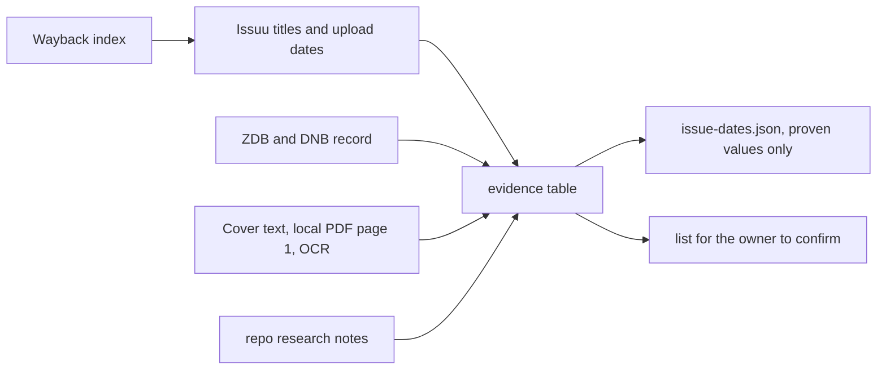

# Issue dates and where they come from

Every date below is either proven by a source or marked as a guess with the rule that produced it. Only proven values go into `data/input/issue-dates.json`. Nothing here has been checked against the printed copies by the owner yet.



Access date for all web sources: 2026-10-30. Issue 10 never existed, so it has no row.

## Evidence table

| Issue | Date | Confidence | Source | Quote or fact |
|---|---|---|---|---|
| 00 | 2008 | proven | https://issuu.com/proud/docs/00-proud-magazine-berlin-dummy-2008 | Issuu title `00-proud-magazine-berlin-dummy-2008`, display title `#00 proud magazine Berlin (dummy)` |
| 01 | 2009-01 | proven | https://issuu.com/proud/docs/01-proud-magazine-berlin-januar-2009 | Issuu slug and display title carry `Januar 2009` |
| 02 | 2009-02 | proven | https://issuu.com/proud/docs/02-proud-magazine-berlin-februar-2009 | Issuu slug carries `februar-2009` |
| 03 | 2009-03 | proven | https://issuu.com/proud/docs/03-proud-magazine-berlin-maerz-2009 | Issuu slug carries `maerz-2009` |
| 04 | 2009-04 | proven | https://issuu.com/proud/docs/04-proud-magazine-berlin-april-2009 | Issuu slug carries `april-2009` |
| 05 | 2009-05 | proven | https://issuu.com/proud/docs/05-proud-magazine-berlin-mai-2009 | Issuu slug carries `mai-2009` |
| 06 | 2009-06 | proven | https://issuu.com/proud/docs/06-proud-magazine-berlin-juni-2009 | Issuu slug carries `juni-2009` |
| 07 | 2009-07 | proven | https://issuu.com/proud/docs/07-proud-magazine-berlin-juli-2009 | Issuu slug carries `juli-2009` |
| 08 | 2009-08 | proven | https://issuu.com/proud/docs/08-proud-magazine-berlin-august-2009 | Issuu slug carries `august-2009` |
| 09 | 2009-10 | proven | https://issuu.com/proud/docs/09-proud-magazine-berlin-oktober-2009 | Issuu slug carries `oktober-2009` |
| 11 | 2009-11 | proven | https://issuu.com/proud/docs/11-proud-magazine-berlin-november-2009 | Issuu slug carries `november-2009` |
| 12 | 2009-12 | proven | https://issuu.com/proud/docs/12-proud-magazine-berlin-dezember-2009 | Issuu slug carries `dezember-2009` |
| 13 | 2010-01 | proven | https://issuu.com/proud/docs/13-proud-magazine-berlin-januar-2010 | Issuu slug carries `januar-2010` |
| 14 | 2010-02 | proven | https://issuu.com/proud/docs/14-proud-magazine-berlin-februar-2010 | Issuu slug carries `februar-2010` |
| 15 | 2010-04 | proven | https://issuu.com/proud/docs/15-proud-magazine-berlin-april-2010 | Issuu slug carries `april-2010`. Second source: ilovegraffiti.de, 13.04.2010, calls issue 15 the current one |
| 16 | 2010-05 | proven | https://issuu.com/proud/docs/16-proud-magazine-berlin-mai-2010 | Issuu slug carries `mai-2010` |
| 17 | 2010-06 | proven | https://issuu.com/proud/docs/17-proud-magazine-berlin-juni-2010 | Issuu slug carries `juni-2010` |
| 18 | 2010-07 | proven | `data/input/pdfs/18 proud issuu_output.pdf`, page 1, top 16 percent | Printed cover line, OCR reads `JULI 2010`. Issuu upload 2012-03-07 under an upload id, so the title carries no date |
| 19 | 2010-09 | proven | https://issuu.com/proud/docs/19-proud-magazine-berlin-september-2010 | Issuu slug carries `september-2010`. Upload 2010-08-16 |
| 20 | 2010 | proven year | `data/input/pdfs/20 proud issuu_output.pdf`, page 1 | Printed cover line, OCR reads `BERLIN 2010`. Month missing on the cover, so month is inferred |
| 21 | 2010-10 | inferred | https://issuu.com/proud/docs/21-proud-magazine | Rule: issue 19 is September 2010 and 21 was uploaded on 2010-10-31. Cover has no date line. Upload date https://issuu.com/proud/docs/21-proud-magazine `datePublished` 2010-10-31 |
| 22 | 2011 | proven year | https://issuu.com/proud/docs/22-proud-magazine-20111, file `data/input/pdfs/22-proud-magazine-2011.pdf` | Issuu slug carries `2011`. The vector PDF prints `3. jahrgang`, `aUSgaBE #22`, `#22 AUSGABE 2011` on pages 1 and 14 |
| 23 | 2011 | proven year | https://issuu.com/proud/docs/23-proud-magazine-2011 | Issuu slug carries `2011`. Cover page 1 prints `3. JAHRGANG AUSGABE #23` |
| 24 | 2011 | proven year | https://issuu.com/proud/docs/24-proud-magazine-berlin-2011 | Issuu slug carries `2011`. Cover prints `3. JAHRGANG AUSGABE #24` |
| 25 | 2011 | proven year | https://issuu.com/proud/docs/25-proud-magazine-berlin-20111 | Issuu slug carries `2011`. Cover prints `3. JAHRGANG AUSGABE #25` |
| 26 | 2011 | proven year | https://issuu.com/proud/docs/26-proud-magazine-berlin-2011 | Issuu slug carries `2011`. Cover prints `AUSGABE #26` and a jahrgang line |
| 27 | 2012-01 | inferred | https://issuu.com/proud/docs/nr-27 | Rule: `datePublished` 2012-01-19, issue 26 is 2011, issue 28 comes after. Cover prints `AUSGABE` with the number washed out by art |
| 28 | 2012-07 | inferred | https://issuu.com/proud/docs/magazine-28 | Rule: `datePublished` 2012-07-18, issue 29 is dated September 2012 by its upload. Cover prints `5. JAHRGANG AUSGABE #28`, the year is not printed |
| 29 | 2012-09 | inferred | https://issuu.com/proud/docs/proud29 | Rule: `datePublished` 2012-09-16. Cover OCR finds no date line |
| 30 | 2013-03 | inferred | https://issuu.com/proud/docs/proud30 | Rule: `datePublished` 2013-03-13, issue 31 comes after. Cover prints `AUSGABE #30` and a jahrgang line |
| 31 | 2013-08 | inferred | https://issuu.com/proud/docs/proud31bunt-2 | Rule: `datePublished` 2013-08-22, issue 32 was uploaded 2014-02-27. Cover OCR finds no date line |
| 32 | 2014 | proven year | https://ld.zdb-services.de/data/2473146-8.jsonld and https://d-nb.info/992028108 | ZDB and DNB: the magazine stopped with issue 32, run 2009-2014, `6. Jahrgang` 2014. Upload date https://issuu.com/proud/docs/proud-magazine-32-single `datePublished` 2014-02-27 |

## Month of issue 20, 21, 22 and 23 in detail

- Issue 18 proves the run was monthly in July 2010 (cover `JULI 2010`).
- Issue 19 is September 2010 and was uploaded on August 16, 2010, so uploads ran about two weeks before the cover month.
- Issue 21 was uploaded on October 31, 2010.
- That leaves issue 20 for October 2010 and issue 21 for November 2010. Both are only guesses, because no page of either issue prints a month.
- Issue 22 is the first issue of `3. Jahrgang` and its opening pages list a party on 21 January 2011 and a `proud talents night` on 26 and 27 February 2011. The issue was therefore on sale in February 2011 or later, so January 2011 is too early.
- Issue 23 follows issue 22, which would put it in March 2011.
- These four guesses hang on each other. One confirmed month from the owner fixes the chain.

## Issuu page counts

The Issuu document pages do not show a page count in their HTML (checked for #23 and #31). Page counts of the local PDFs are in `.worktrees/_launch/BRIEF-COMMON.md` and are proven with `pdfinfo`. Cross-checking against Issuu is therefore not possible from the public side.

## Only the owner can confirm

- Month of issue 20. Cover says `BERLIN 2010` only.
- Month of issue 21 (guess October 2010).
- Month of issue 22 (guess February 2011), 23 (guess March 2011), 24, 25, 26 (2011, months open).
- Month and year of issue 27 (guess January 2012).
- Month and year of issue 28 (guess July 2012), 29 (guess September 2012), 30 (guess March 2013), 31 (guess August 2013).
- Month of issue 32 (year 2014 is proven by the library record, the month is not).
- Whether issue 09 is October 2009 and issue 08 August 2009, so that September 2009 was skipped.
- Whether issue 19 is September 2010 and issue 18 July 2010, so that August 2010 was skipped.

## How the cover text was read

The owner is the only one who can look at covers in the browser. This task read the printed cover line with OCR from the local PDFs:

```sh
pdftoppm -r 110 -f 1 -l 1 -jpeg "data/input/pdfs/18 proud issuu_output.pdf" p18
magick p18-01.jpg -gravity North -crop 100%x16%+0+0 +repage -colorspace Gray -resize 200% c-p18.jpg
tesseract c-p18.jpg - -l eng
```

Same command for issue 20 gives `BERLIN 2010`. For issues 21 and 23 to 32 the same crop holds only `N. JAHRGANG` and `AUSGABE #NN`, never a month.

## Blocked and missing sources

- `https://issuu.com/proud` answers HTTP 503 for plain curl. With a browser User-Agent it answers HTTP 200 and lists #00 to #32 with upload dates. The old Issuu profile API path `/call/profile/v1/documents/proud` answers 503 `no_route`.
- The Issuu reader JSON `https://reader3.isu.pub/proud/<revision>/reader3_4.json` answers 403 AccessDenied, so no full-text search of the issues was possible.
- Wayback Machine listing snapshots of `issuu.com/proud` are JavaScript shells, the document list is not in the HTML. The Wayback CDX index was unreachable for long stretches on 2026-10-30 (`Internet Archive: Temporarily Offline`).
- The rendered imprint pages of 21 to 32 carry names and roles, no date line. OCR of the imprint pages of 21 to 32 found no month.
- `rclone lsjson proud-gdrive:proud` fails with `directory not found`, so the owner's Drive file names are not part of this table. UNVERIFIED whether another remote name or path is right.
