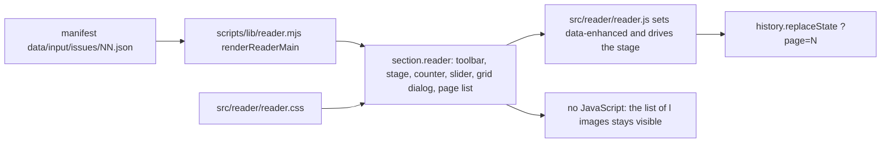

# Page reader

One issue, page by page, in the order of the printed magazine. Cover alone, then facing pairs, last page alone. Works without JavaScript as a plain list of pages.



## Files

| File | Role |
|---|---|
| `scripts/lib/reader.mjs` | Server side. `READER_TEXT`, `READER_JS_PATH`, `READER_CSS_PATH`, `renderReaderMain`. |
| `src/reader/reader.js` | Browser side ES module. Pure view helpers plus init. No dependencies. |
| `src/reader/reader.css` | Styles. Stage, spine, toolbar, grid dialog, list. |
| `tests/reader.test.mjs` | View maths, dictionaries, rendered HTML. |
| `tests/fixtures/reader-manifest.json` | 10 page fixture in CONTRACT v1 shape. No images in git. |

## Wiring (task S)

1. Copy `READER_JS_PATH` to `site/assets/reader.js` and `READER_CSS_PATH` to `site/assets/reader.css`.
2. Add `<link rel="stylesheet" href="/assets/reader.css?v=SHA8">` and `<script type="module" src="/assets/reader.js?v=SHA8"></script>` to the issue page.
3. Put `renderReaderMain({ locale, manifest, assetBase: "/assets/issues/NN", version: SHA8, title, dateLabel, hrefs: { overview, issue }, startPage })` inside the site layout.

The `:root` tokens and the `.label-title` rules must be in scope. The reader section itself carries no width of its own beyond `min(var(--wrap), calc(100vw - 2.5rem))`.

## Text

All reader words live in `READER_TEXT` with the keys `pdf`, `pages`, `close`, `previous`, `next`, `first`, `last`, `counterSingle`, `counterPair`, `pageAlt`, `backToIssue`, `jumpToPage`, `gridTitle`, `listIntro`. German and English have the same keys, a test checks it. An unknown locale falls back to English. `{a}`, `{b}`, `{n}` and `{mb}` are filled at render time. No em dashes, the pair counter uses an en dash.

## Behaviour

| Input | Action |
|---|---|
| ArrowRight, PageDown, Space | next page |
| ArrowLeft, PageUp, Shift+Space | previous page |
| Home | first page |
| End | last page |
| Horizontal swipe over 50 px | next or previous, ignored while pinch zoomed |
| Slider | jump, `aria-valuetext` repeats the counter |
| Pages button | grid dialog, thumbnail jumps and returns focus |

Pair mode needs a stage of at least 900 CSS px that is wider than tall, otherwise one page at a time. Resize is debounced and keeps the first page of the view.

`?page=N` carries the first page of the view, written with `history.replaceState`, so Back leaves the reader. The query wins over `startPage`. Junk, zero and negatives mean page 1, too large means the last page.

Without JavaScript the stage, counter, slider and Pages button stay hidden and the list of all pages shows. With JavaScript the section gets `data-enhanced="true"` and the list hides.

The next view is preloaded with detached `Image` objects that carry the same `srcset` and `sizes`. The turn effect is a 150 ms fade (75 ms out, 75 ms in) and is skipped under `prefers-reduced-motion: reduce`.

## Browser proof

Headless Chrome 156 over DevTools protocol, real pages of issue 24 (`data/output/issues/24/pages`, 68 pages), German UI, page `?page=6` unless noted. `--reader-offset: 0px`, so the page may use the full viewport height. All numbers are px and measure the drawn picture (the `img` box shrunk to what `object-fit: contain` really paints), not the box.

| Viewport | Mode | Drawn picture (each) | Left and right picture edge | Picture height | Side margins | Sideways scroll (scrollWidth of clientWidth) | Slider row in view |
|---|---|---|---|---|---|---|---|
| 1440x900 | pair | 535.9 x 718.9 | 720 and 720, gap 0 | 719 (80 % of 900) | 24.1 and 24.1 inside the 1120 column | 1440 of 1440 | bottom at 892 of 900 |
| 1024x768 | pair | 437.5 x 587.1 | 512 and 512, gap 0 | 587 (76 %) | 54.5 and 54.5 | 1024 of 1024 | bottom at 760 of 768 |
| 390x844 | single | 374 x 501.5 | not applicable | 501 | 8 and 8 | 390 of 390 | bottom at 836 of 844 |
| 360x740 | single | 344 x 461.5 | not applicable | 461 | 8 and 8 | 360 of 360 | bottom at 732 of 740 |

The old claim "gap 0" measured the image boxes, which were 50 % wide with a smaller picture inside. The pictures now fill their boxes. A 1 px border on the right page used to draw a light line down the middle (gray step of 154 between the two columns at x = 719 and 720 on pages 4 and 5). The border is gone and the largest step between neighbouring columns at the join is 2.7.

Mobile widths are measured against the nominal width (390, 360), not `innerWidth`: mobile emulation reports `innerWidth` 4 px too large when the page overflows, which hid a 4 px overflow in the first version.

Toolbar (all viewports): link back, Pages and PDF are 17.6 px, underlined, 44 px high (widths 158, 71, 117 at 1440; 152, 65, 110 at 390). Arrows: 48 px glyph, paper-colored outline of 2 px plus a 6 px blur, tap area 48 px wide and as high as the picture. At 640 px and below previous and next also sit in the control row, 44 x 50 px each.

Keys on page 4 and 5: ArrowLeft goes to 2-3. Cmd+ArrowLeft stays on 2-3 and is not default-prevented. Space on the focused Pages button opens the dialog and the page stays at 4-5. ArrowRight with focus on the PDF link turns to 6-7.

Srcset of a spread half: `002-m.webp 900w, 002-l.webp 1492w` (file widths 900 and 1492). Covers: `001-l.webp 1800w`.

Not measured here: Safari, real touch devices, the swipe and zoom checks of the first version (unchanged code).

## Run the checks

```sh
npm test
node --check src/reader/reader.js
node --check scripts/lib/reader.mjs
```

Browser proof needs a demo page outside git: `renderReaderMain` output for issue 24 with `assets/issues` linked to `data/output/issues`, served by `python3 -m http.server`, and headless Chrome with `--remote-debugging-port`. The measuring scripts are not committed.
