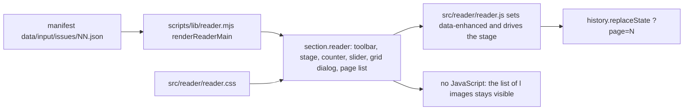

# Page reader

One issue, page by page, in the order of the printed magazine. Cover alone, then facing pairs, last page alone. Works without JavaScript as a plain list of pages.



## Files

| File | Role |
|---|---|
| `scripts/lib/reader.mjs` | Server side. `READER_TEXT`, `READER_JS_PATH`, `READER_CSS_PATH`, `renderReaderMain`. |
| `src/reader/reader.js` | Browser side ES module. Pure view helpers plus init. No dependencies. |
| `src/reader/reader.css` | Styles. Stage, spine, toolbar, grid dialog, list. |
| `tests/reader.test.mjs` | View maths, dictionaries, rendered HTML. |
| `tests/fixtures/reader-manifest.json` | 10 page fixture in CONTRACT v1 shape. No images in git. |

## Wiring (task S)

1. Copy `READER_JS_PATH` to `site/assets/reader.js` and `READER_CSS_PATH` to `site/assets/reader.css`.
2. Add `<link rel="stylesheet" href="/assets/reader.css?v=SHA8">` and `<script type="module" src="/assets/reader.js?v=SHA8"></script>` to the issue page.
3. Put `renderReaderMain({ locale, manifest, assetBase: "/assets/issues/NN", version: SHA8, title, dateLabel, hrefs: { overview, issue }, startPage })` inside the site layout.

The `:root` tokens and the `.label-title` rules must be in scope. The reader section itself carries no width of its own beyond `min(var(--wrap), calc(100vw - 2.5rem))`.

## Text

All reader words live in `READER_TEXT` with the keys `pdf`, `pages`, `close`, `previous`, `next`, `first`, `last`, `counterSingle`, `counterPair`, `pageAlt`, `backToIssue`, `jumpToPage`, `gridTitle`, `listIntro`. German and English have the same keys, a test checks it. An unknown locale falls back to English. `{a}`, `{b}`, `{n}` and `{mb}` are filled at render time. No em dashes, the pair counter uses an en dash.

## Behaviour

| Input | Action |
|---|---|
| ArrowRight, PageDown, Space | next page |
| ArrowLeft, PageUp, Shift+Space | previous page |
| Home | first page |
| End | last page |
| Horizontal swipe over 50 px | next or previous, ignored while pinch zoomed |
| Slider | jump, `aria-valuetext` repeats the counter |
| Pages button | grid dialog, thumbnail jumps and returns focus |

Pair mode needs a stage of at least 900 CSS px that is wider than tall, otherwise one page at a time. Resize is debounced and keeps the first page of the view.

`?page=N` carries the first page of the view, written with `history.replaceState`, so Back leaves the reader. The query wins over `startPage`. Junk, zero and negatives mean page 1, too large means the last page.

Without JavaScript the stage, counter, slider and Pages button stay hidden and the list of all pages shows. With JavaScript the section gets `data-enhanced="true"` and the list hides.

The next view is preloaded with detached `Image` objects that carry the same `srcset` and `sizes`. The turn effect is a 150 ms fade (75 ms out, 75 ms in) and is skipped under `prefers-reduced-motion: reduce`.

## Browser proof

Measured with headless Chrome 156 over DevTools protocol, server `python3 -m http.server`, 10 page fixture at 1800 px wide images, German UI.

| Viewport | Mode | Images after three ArrowRight | No sideways scroll | Smallest button box | Counter font | After Home / End | `?page` after End | Reduced motion |
|---|---|---|---|---|---|---|---|---|
| 1440x900 | pair | 2-3, 4-5, 6-7 | yes, 1440 of 1440 | 44 px | 17.6 px | Seite 1 / Seite 10 | 10 | transition 0 s, same images and counter |
| 1024x768 | pair | 2-3, 4-5, 6-7 | yes, 1024 of 1024 | 44 px | 17.6 px | Seite 1 / Seite 10 | 10 | transition 0 s, same images and counter |
| 390x844 | single | 2, 3, 4 | yes, 390 of 390 | 44 px | 17.6 px | Seite 1 / Seite 10 | 10 | transition 0 s, same images and counter |
| 360x740 | single | 2, 3, 4 | yes, 360 of 360 | 44 px | 17.6 px | Seite 1 / Seite 10 | 10 | transition 0 s, same images and counter |

Spine at 1440: two images, 560 and 561 px wide, gap 0, 1 px `--line` border on the right page.

Swipe: from page 5 a left swipe went to page 6, a right swipe back to 5, a left swipe at zoom factor 2 stayed on 5. Preload: showing page 5 requested `007-m.webp` before it was visible.

No JavaScript at 390: 10 list items visible with `srcset` and `?v=`, stage hidden, Pages button hidden.

Grid: dialog opens with focus inside, page 7 jumps and closes, focus returns to the Pages button. Slider at 4 sets `aria-valuetext` `Seite 4 von 10` and `?page=4`.

Transition duration came from `getComputedStyle(.reader-spread).transitionDuration`, 0.075 s normally and 0 s with emulated reduced motion.

## Run the checks

```sh
npm test
node --check src/reader/reader.js
node --check scripts/lib/reader.mjs
```

Browser proof needs a demo build outside git: 10 white images per page in three sizes, `renderReaderMain` output, `python3 -m http.server 8790`, headless Chrome with `--remote-debugging-port=9422`. Screenshots from the run: `/Users/eminmahrt/.hermes/cache/scratch/r-demo/shot-1440-pair.png`, `shot-360-single.png`, `shot-grid.png`.
